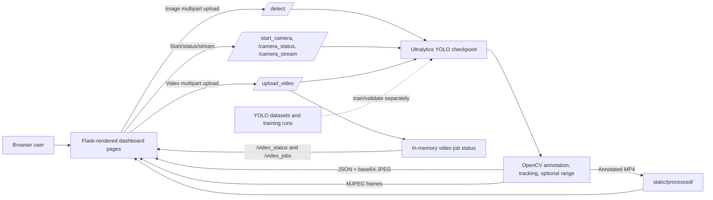

# Multicopter Drone Detection

A Flask and Ultralytics YOLO application for detecting multicopters/drones from uploaded images, a live camera stream, and uploaded videos. It draws detections onto the image/video and provides a browser dashboard with confidence, target position, tracking IDs, and an image-plane map.

> **Scope:** This project detects and visualizes objects. The inspected app does not send commands to a drone or provide flight control. Its map is a perspective-styled visualization of camera-image coordinates, not a measured 3D reconstruction. A single ordinary camera cannot determine true depth without calibration or another depth source.

## Demo media

<div align="center">


<video controls width="1100" height="1200" style="max-width: 100%; object-fit: contain;">
    <source src="https://github.com/user-attachments/assets/fd450cb7-b238-4b9f-9230-d96ba72c6090" type="video/mp4">
    Your browser does not support MP4 video playback. [Play or download the sample video](Recording%202026-10-19%20181230.mp4).
</video>
</div>

The fullscreen icon is provided by your browser's video controls. Some Markdown previews block fullscreen; use a browser/viewer that permits fullscreen video.

## Contents

- [Features](#features)
- [Demo media](#demo-media)
- [System architecture](#system-architecture)
- [Detection pipelines](#detection-pipelines)
- [Repository layout](#repository-layout)
- [Requirements and setup](#requirements-and-setup)
- [Run the application](#run-the-application)
- [Web pages and API](#web-pages-and-api)
- [Distance calibration](#distance-calibration)
- [Dataset and training assets](#dataset-and-training-assets)
- [Outputs and persistence](#outputs-and-persistence)
- [Known limitations and troubleshooting](#known-limitations-and-troubleshooting)
- [Security and deployment](#security-and-deployment)

## Features

- **Image detection:** upload an image and receive an annotated image plus detection metadata.
- **Live camera:** start a webcam or compatible IP-camera stream, view annotated MJPEG frames, and poll live detections/FPS.
- **Video detection:** upload a video, process it asynchronously, monitor job progress, preview the annotated MP4, and download it.
- **Detection annotation:** bounding boxes, class/confidence labels, target center, optional crosshair, and guidance relative to the image center.
- **Target tracking:** a lightweight per-stream IoU tracker assigns IDs and smooths target image centers. This is not a robust multi-object tracking system and IDs may change after long gaps or crossings.
- **Detection map:** displays tracked detections on a perspective-styled map using their image coordinates. The panel embedded in live and processed video is rendered by OpenCV; the browser pages draw their own maps.
- **Optional edge filtering:** detections touching the outer 6% of a frame can be ignored.
- **Optional range estimate:** with a calibrated focal length in pixels and the detected drone's real width, the app estimates range using a pinhole-camera formula. Without these values, FAR/MID/NEAR is only a rough apparent-size heuristic.

## System architecture



### Main components

1. **Browser UI** — [templates/index.html](templates/index.html) provides live camera and image upload; [templates/camera.html](templates/camera.html) is a dedicated camera page; [templates/video.html](templates/video.html) is the video-upload page.
2. **Flask backend** — [2.py](2.py) defines pages and APIs, loads the configured YOLO checkpoint, performs inference, annotates frames, streams camera output, and manages video jobs.
3. **Model** — the configured checkpoint is `runs/combined_yolo11l_1024/weights/best.pt`. It is loaded once when the Python module starts.
4. **Data and experiments** — dataset folders and Ultralytics run logs/checkpoints are stored in the workspace. Dataset preparation/training is separate from web-app inference.

## Detection pipelines

### Uploaded image

1. The browser sends the selected image and options as multipart form data to `POST /detect`.
2. Flask reads and decodes the image with OpenCV.
3. Ultralytics YOLO runs inference using the requested confidence threshold.
4. The backend draws boxes/labels and computes target center, dimensions, confidence, class, and direction relative to the image center. Optional edge filtering and range calibration are applied when supplied.
5. The response includes detections and a JPEG encoded as base64; the page displays the annotated image and detection map.

Image upload is a single-frame operation; target IDs in an image result are not persistent identities across images.

### Live camera

1. `POST /start_camera` opens a camera index or a source string/stream URL.
2. `/camera_stream` reads frames, runs YOLO, annotates the current frame, updates the in-memory camera status, adds a map overlay, JPEG-encodes the result, and serves it as an MJPEG stream.
3. The browser separately polls `/camera_status` for detections and FPS and draws the interactive map.
4. `POST /stop_camera` releases the source.

The frontend offers camera index examples `0` and `1` and an example IP-camera URL. Replace the example URL with the actual reachable stream address for your camera.

### Uploaded video

1. The browser posts the file and processing options to `POST /upload_video`.
2. Flask saves it in `static/uploads/`, creates an in-memory job record, and starts a daemon worker thread.
3. The worker reads frames, runs YOLO on selected frames, tracks detections, annotates frames, adds the map panel, and writes an MP4 to `static/processed/`.
4. The UI polls `/video_status/<job_id>` for progress and latest detections, then shows the output player and download link when complete.

**Frame skipping note:** when `skip_frames` is greater than 1, the worker writes one output frame for every input frame and repeats the most recent annotated frame between inference frames. It also divides output FPS by the skip value. This reduces inference work but can make output playback longer/slower than the source; use `1` when preserving source timing matters.

## Repository layout

| Path | Purpose |
| --- | --- |
| `2.py` | Current Flask application: model loading, inference, camera streaming, video jobs, map/annotation, and APIs. |
| `1.py` | Older Flask application copy; it may not include current settings/calibration endpoints. Prefer `2.py` with the current templates. |
| `templates/index.html` | Main live-camera and image-upload dashboard. |
| `templates/camera.html` | Dedicated live-camera dashboard. |
| `templates/video.html` | Video upload, progress, result, and job-history UI. |
| `runs/` | Ultralytics training run arguments, metrics/logs, and checkpoints. |
| `combined_dataset/` | Dataset used by the `combined_yolo11l_1024` run; its YAML declares one class, `multicopter`. |
| `drone_octocopter_dataset/`, `combine/`, `new_dataset_check/`, `octacopter_temp/`, `octacoptor/`, `yolo_dataset/` | Other dataset variants/configurations. Check each `data.yaml`; they do not all use the same classes or paths. |
| `train/`, `valid/`, `test/`, `uploads/` | Additional dataset/image folders in the workspace. |
| `archive/` | Older assets, datasets, and [archive/1.py](archive/1.py), a dataset conversion/splitting utility. |
| `yolo11l.pt`, `yolo11m.pt`, `yolo11x.pt`, `yolo26n.pt` | Additional model weights; the web app uses the checkpoint configured in `2.py`, not automatically the root-level weights. |
| `static/uploads/` | Uploaded source videos. |
| `static/processed/` | Generated annotated videos. |
| `static/captures/` | Captured annotated live frames. |

Generated uploads, processed videos, captures, and training weights can be large; keep them out of source control if appropriate for your project.

## Requirements and setup

No `requirements.txt`, `pyproject.toml`, or environment file is currently present. The app imports Flask, Flask-CORS, OpenCV, NumPy, and Ultralytics. Video/dataset utilities in the archive additionally use scikit-learn and tqdm.

### Windows PowerShell setup

Run from the project root (`D:\Multicopter`):

```powershell
py -m venv .venv
.\.venv\Scripts\Activate.ps1
python -m pip install --upgrade pip
python -m pip install flask flask-cors opencv-python numpy ultralytics
```

For the optional archived dataset utility:

```powershell
python -m pip install scikit-learn tqdm
```

Ultralytics/PyTorch GPU setup depends on the installed CUDA/runtime and hardware. If using a GPU, install the PyTorch build appropriate for the machine using the official PyTorch installation instructions, then verify that Ultralytics can see the device. CPU inference may be slower. The app's video processing uses OpenCV codec support for MP4 writing.

### Model checkpoint path

`2.py` currently uses the Windows absolute path:

```text
D:\Multicopter\runs\combined_yolo11l_1024\weights\best.pt
```

This checkpoint exists in the current workspace. If the project is moved or a different model should be used, update `MODEL_PATH` near the top of `2.py` to the desired `.pt` checkpoint before starting the app. The application loads the model at startup, so a missing/incompatible checkpoint prevents startup.

## Run the application

From the project root, with the environment active and checkpoint available:

```powershell
python .\2.py
```

The Flask development server is configured for port `5000` and binds to `0.0.0.0`. Open these pages in a browser:

- Main dashboard: `http://localhost:5000/`
- Dedicated live camera: `http://localhost:5000/camera`
- Video upload: `http://localhost:5000/video`

Allow the app time to load the YOLO model before using it. Stop it with `Ctrl+C` in the terminal.

## Web pages and API

| Method | Endpoint | Purpose |
| --- | --- | --- |
| `GET` | `/` | Main live-camera/image dashboard. |
| `GET` | `/camera` | Dedicated live-camera page. |
| `GET` | `/video` | Video-upload page. |
| `POST` | `/detect` | Run inference on an uploaded image. |
| `POST` | `/start_camera` | Start a camera/source; accepts JSON `source`. |
| `GET` | `/camera_stream` | Annotated MJPEG stream. |
| `GET` | `/camera_status` | Current active state, FPS, detections, frame size, and range-calibration state. |
| `POST` | `/stop_camera` | Stop and release the active camera. |
| `POST` | `/set_threshold` | Update the live confidence threshold; JSON `{ "confidence": 0.5 }`. |
| `POST` | `/set_display_options` | Toggle center/crosshair annotations. |
| `POST` | `/set_detection_options` | Configure edge filtering and live range calibration. |
| `POST` | `/capture_frame` | Save and return the latest annotated camera frame. |
| `POST` | `/upload_video` | Save a video and start asynchronous processing. |
| `GET` | `/video_status/<job_id>` | Read one video-processing job's progress/result. |
| `GET` | `/video_jobs` | List video jobs kept in memory. |
| `GET` | `/get_stats` | Read camera detection stats. |
| `GET` | `/health` | Report server/model status and model class names. |
| `GET` | `/static/<path>` | Serve generated/static files. |

### Options

- **Confidence threshold:** higher values generally reduce low-confidence detections but may miss harder/smaller targets.
- **Ignore frame edges:** suppresses boxes that touch the outer 6% of image width/height. This can also hide a real target near an edge.
- **Range calibration:** live controls set focal length in pixels and drone width in meters. Video upload has its own corresponding fields. Image upload uses the main dashboard calibration fields plus its own edge-ignore checkbox.
- **Center/crosshair:** changes the annotation drawn over source frames.

## Distance calibration

The range estimate uses the pinhole-camera approximation:

$$
\text{distance}_{m} \approx
\frac{\text{focal length}_{px} \times \text{known drone width}_{m}}
{\text{detected drone width}_{px}}
$$

To determine focal length in pixels, measure a known object's pixel width at a known distance using the same camera, zoom, resolution, and lens configuration:

$$
\text{focal length}_{px} \approx
\frac{\text{observed width}_{px} \times \text{known distance}_{m}}
{\text{real object width}_{m}}
$$

Enter that focal length and the actual width of the target drone. Estimates are only as reliable as the calibration and bounding box. Changing camera zoom, resolution, crop, or lens invalidates the calibration. If not calibrated, FAR/MID/NEAR labels are heuristic—not a distance measurement. A single camera also cannot supply altitude or full 3D coordinates from these values alone.

## Dataset and training assets

- The configured training run `runs/combined_yolo11l_1024/args.yaml` records Ultralytics training with `yolo11l.pt`, `combined_dataset/data.yaml`, 100 epochs, image size 1024, batch size 8, and device `0`.
- `combined_dataset/data.yaml` declares one class (`multicopter`) and train/validation/test folders. Confirm the YAML paths and label class IDs match the model/checkpoint before training or evaluating.
- Other dataset YAMLs declare different classes and/or directory layouts. Do not interchange them without checking the annotation IDs and class names.
- [archive/1.py](archive/1.py) prepares data by finding image/label pairs, converting labels, splitting into train/validation/test, writing a YAML, and verifying the output. It is a data-preparation script, not the model trainer. Its source path is hard-coded, and its drone folder list contains `DJIPhamton`, which may not match the workspace folder spelling `DJIPhantom`; edit its configuration before reuse.
- The generated `yolo_dataset/data.yaml` has a Windows absolute path that may be stale on another machine. Prefer portable relative paths or update the `path` value when moving datasets.

No dedicated, maintained training command/script is currently defined at the repository root. Use Ultralytics CLI/Python training with the intended dataset YAML and save the resulting checkpoint, then update `MODEL_PATH` in `2.py` to use it.

## Outputs and persistence

- Uploaded source video: `static/uploads/`
- Processed video: `static/processed/`
- Captured camera frames: `static/captures/`
- Training artifacts/checkpoints: `runs/`

The video job registry is an in-memory Python dictionary, and processing runs in daemon threads. Restarting the Flask process loses job history and interrupts jobs still running. Files written under `static/` remain on disk unless manually removed. Paths for these folders are relative to the current working directory, so start the app from the project root.

## Known limitations and troubleshooting

- **App fails during startup:** read the Python traceback. Typical causes are a missing dependency, unavailable checkpoint at `MODEL_PATH`, incompatible Torch/Ultralytics install, or insufficient memory.
- **Camera won't open:** verify the selected webcam index/stream URL, camera permissions, and that another application is not holding the camera. For network streams, confirm the URL is reachable from the app host.
- **No detections:** check `/health`, confirm the loaded checkpoint is the expected one, lower the confidence threshold, and verify the model's classes and training labels.
- **Video output will not play:** verify OpenCV/FFmpeg codec support and retry with a supported MP4 input. Check the worker's job error from `/video_status/<job_id>`.
- **Range seems inaccurate:** recalibrate for the exact camera/resolution/zoom and use the real width of the detected target. Without calibration, ignore FAR/MID/NEAR as physical distance.
- **Tracking IDs change:** IDs come from simple IoU matching, are local to a camera/video processing stream, and are not visual identity recognition. Fast motion, overlap, missed detections, and frame skipping can cause ID changes.
- **Video timing changes with skipped frames:** set frame skip to `1` if preserving playback timing is more important than reducing inference calls.
- **Older app entry point:** `1.py` is an older copy and may not implement endpoints used by the current templates. Use `2.py` unless intentionally maintaining the older version.

## Security and deployment

The app currently starts Flask with `debug=True`, accepts uploads, enables CORS, and binds to `0.0.0.0`. This is for local development—not a production configuration. Before exposing it to a network or the internet:

- turn off debug mode and use a production WSGI server;
- restrict CORS to trusted origins;
- add authentication/authorization and upload size/type limits;
- validate and safely retain uploaded files; implement cleanup/retention limits;
- use a persistent job queue/store if jobs must survive restarts;
- place the service behind HTTPS and network access controls.


